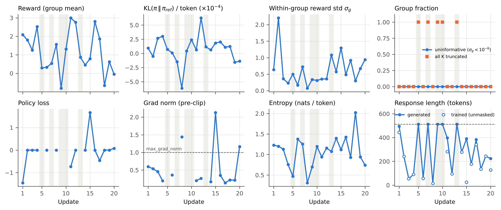
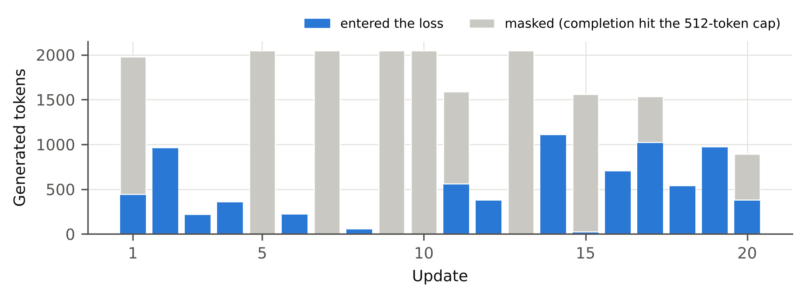
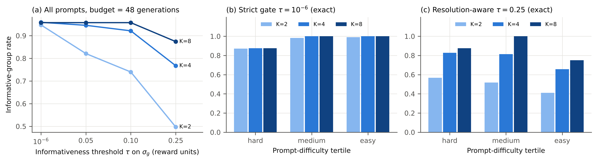
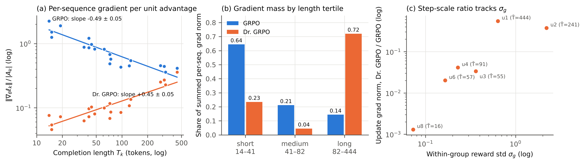
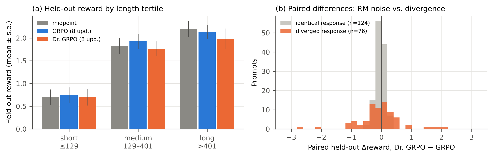

# 3 Group Relative Policy Optimization (GRPO)

*All statistics are computed from the Kaggle run artifacts in `results/task3_grpo/` and the course cache `cached/grpo_k_cache.jsonl` by `analysis/task3_report_stats.py`. Its outputs are in this folder: `stats.json`, `tables/*.csv` and `figures/*.png|pdf`. Uncertainties are ± one standard error unless stated otherwise.*

## 3.1 Setup and objective validation

**Models and data.** The policy is Qwen2.5-1.5B-Instruct with the supplied GRPO midpoint LoRA adapter (r = 8, α = 16, on `q_proj` and `v_proj`). The midpoint was produced by 50 TRL steps at K = 4 with a 512-token cap. Its log reports reward 1.379, within-group reward std 0.687, a zero-std group fraction of 0.02 and a clipped (truncated) completion ratio of 0.245. The reference policy is the frozen base model. The reward is the course reward model (`yavuz-ai/qwen2.5-1.5b-rm-ultrafeedback`, 8-bit). Prompts come from the UltraFeedback pool used for PPO.

**Continuation protocol.** Each update draws one prompt from a fixed, seeded schedule and samples K = 4 completions at temperature 0.7 and top-p 0.9, with at most 512 new tokens. All four are scored by the RM. The update is a single policy epoch with learning rate 5·10⁻⁶, ε = 0.2, β = 0.1, gradient clipping at 1.0 and seed 6304. A completion that ends without EOS at the cap is removed from the loss (`mask_truncated_completions`).

**Hardware.** Two Kaggle T4 GPUs: the trainable policy sits on `cuda:0`, and the fp16 reference plus the 8-bit RM are pinned to `cuda:1`.

**Held-out protocol.** Every condition is evaluated on the same 200 held-out prompts with a 768-token cap, in the same order and with the same per-batch seeds (common random numbers). Held-out KL is measured against the adapter-disabled base model.

**Objective.** For prompt $x$ with completions $o_1,\dots,o_K$ and rewards $r_k$, the canonical objective (Shao et al., 2024) is

$$
A_k=\frac{r_k-\mu_g}{\sigma_g+\varepsilon},\qquad
\mathcal{L}_{\text{GRPO}}=-\frac{1}{N}\sum_{k\in\mathcal{V}}\frac{1}{T_k}\sum_{t=1}^{T_k}\min\!\big(\rho_{k,t}A_k,\ \mathrm{clip}(\rho_{k,t},1\!-\!\epsilon,1\!+\!\epsilon)A_k\big)+\beta\,\widehat{D}_{\text{KL}}.
$$

Here $\mu_g$ and $\sigma_g$ are the mean and population std of the $K$ rewards **of the same prompt**. $\mathcal{V}$ is the set of $N$ unmasked completions, and $\widehat{D}_{\text{KL}}$ is the per-token k3 estimator $\pi_{\text{ref}}/\pi_\theta-\log(\pi_{\text{ref}}/\pi_\theta)-1$. Groups with $\sigma_g<10^{-6}$ are declared *uninformative* and receive $A_k=0$ exactly.

The Dr. GRPO branch (Liu et al., 2025) changes exactly two things and nothing else:
- the advantage is $A_k=r_k-\mu_g$, with no division by $\sigma_g$;
- the sequence weight $1/T_k$ is replaced by the constant $1/L_{\max}$, with $L_{\max}=512$.

**The deliberate defect.** The supplied `group_relative_advantages` computed $\mu$ and $\sigma$ over the *whole batch* and ignored `group_ids`. This makes the advantage encode prompt difficulty rather than within-prompt quality. With several prompts per batch, every completion of an easy prompt receives $A>0$ even when its K completions are indistinguishable, and a zero-variance group is never mapped to $A=0$.

With the prescribed one prompt per update, the batch *is* the group, so the bug happened to be numerically latent in the continuation run. It would have corrupted any multi-prompt update and the regrouped analysis in §3.3. We replaced it with per-group statistics plus the explicit zero-variance gate.

A second, smaller correction concerns masked completions. The starter averaged the per-sequence objective over all $B$ rows, so each masked completion entered the denominator as a zero and silently shrank the step of the surviving ones. The expectation now runs over unmasked completions only, and an update in which all $K$ completions are masked takes no optimizer step.

**Validation (`validate_grpo_objective`, executed before every training loop; 3/3 invocations passed).** The test compares against brute-force scalar references.
- **Advantages.** They match the per-group formula to 10⁻⁵ on interleaved, unsorted groups. They are invariant to adding a per-prompt reward offset; the starter fails this check, so the test has power. Informative groups have zero mean and unit std, and a group of identical rewards, including a float-rounding near-tie, yields $A=0$ exactly.
- **Loss.** It matches the brute-force value for both normalizations, ε ∈ {0.05, 0.2, 0.5} and β ∈ {0, 0.1}. The clipped surrogate never exceeds the unclipped one. Clip-active tokens, padding and masked completions receive exactly zero gradient.
- **Token weights.** At ρ = 1 the per-token gradient equals $-A_k/(D_k N)$, with $D_k=T_k$ for GRPO and $D_k=L_{\max}$ for Dr. GRPO.
- **Micro-batching.** Single-sequence micro-batches with global normalizers reproduce the full-batch gradient.
- **Determinism.** Updates 1–8 of the standard run and the 8-update GRPO fork agree to a maximum absolute difference of **0.0** on every logged scalar.

## 3.2 Standard GRPO continuation (20 updates, K = 4)

**Table 3.1 — Run-level diagnostics of the standard continuation** (`standard/summary.json`).

| Quantity | Value |
|---|---|
| **Wall-clock time (training loop)** | **404.7 s** (6.7 min); 20.2 s / update (range 2.7–29.2 s) |
| **Peak VRAM, `torch.cuda.max_memory_allocated`** | **cuda:0 (policy) 3.99 GiB; cuda:1 (reference + 8-bit RM) 5.34 GiB** |
| Held-out evaluation (200 prompts, 768-token cap) | 1003.7 s |
| Generated / trained tokens | 23,347 / 7,987 (34.2 % entered the loss) |
| Completions masked at the 512 cap | 30 / 80 (37.5 %) |
| Updates with no optimizer step (all K masked) | 5 / 20 (updates 5, 7, 9, 10, 13) |
| Uninformative groups ($\sigma_g<10^{-6}$) | 0 / 20 |
| Within-group reward std $\sigma_g$ | mean 0.626 (Bessel-corrected 0.722), range 0.073–2.204 |
| KL to reference, sampled k1 / k3 per token | k1 in [−6.1, +6.3]·10⁻⁴; k3 in [0.5, 3.9]·10⁻⁵ |
| Importance ratio ρ, clip fraction | ρ ≡ 1.000, clip fraction 0 in all 15 stepped updates |
| Pre-clip gradient norm | mean 0.563, CV 0.99, max 2.13; > 1.0 in 3 / 15 steps (updates 8, 15, 20) |
| Full-vocabulary entropy | 0.31–2.02 nats / token (mean 1.07) |
| First-5 vs last-5 updates | reward 1.593 → 0.920; length 278.7 → 232.7; truncation 0.35 → 0.10; σ_g 0.786 → 0.662 |

*Figure 1. Per-update diagnostics of the standard continuation. Gray bands mark the five updates in which all K = 4 completions hit the 512-token cap, were masked, and produced no gradient. Lines break where a quantity is undefined. No group was uninformative (σ_g < 10⁻⁶) in any update (top right), whereas all-truncated groups occur in 25 % of updates. In the length panel, filled markers are generated length and open markers are the length of the completions that entered the loss; the dashed line is the 512-token cap.*

**Table 3.2 — Per-update trajectory** (`standard/metrics.jsonl`).
- $\bar r$ and $\sigma_g$ are the group mean and population std of the RM reward.
- KL is the sampled k1 estimate per generated token. $\mathcal{L}_\pi$ is the policy term and $\|g\|$ the pre-clip gradient norm.
- $H$ is the full-vocabulary entropy per token.

| Upd. | Prompt | $\bar r$ | $\sigma_g$ | Uninf. | Masked / K | KL (10⁻⁴) | $\mathcal{L}_\pi$ | $\|g\|$ | $H$ | Len. gen. / trained | Step | Time (s) |
|---:|---:|---:|---:|---:|---:|---:|---:|---:|---:|---:|:---:|---:|
| 1 | 66 | +2.088 | 0.636 | 0 | 3/4 | +0.94 | −1.452 | 0.599 | 1.228 | 495.0 / 444.0 | ✓ | 28.3 |
| 2 | 211 | +1.800 | 2.204 | 0 | 0/4 | −0.52 | 0.000 | 0.536 | 1.202 | 241.0 / 241.0 | ✓ | 17.9 |
| 3 | 223 | +1.254 | 0.361 | 0 | 0/4 | +2.67 | 0.000 | 0.457 | 1.132 | 54.8 / 54.8 | ✓ | 8.0 |
| 4 | 141 | +2.529 | 0.229 | 0 | 0/4 | +3.03 | 0.000 | 0.198 | 0.757 | 90.8 / 90.8 | ✓ | 7.8 |
| 5 | 762 | +0.291 | 0.501 | 0 | 4/4 | +0.71 | — | — | 0.469 | 512.0 / — | ✗ | 26.6 |
| 6 | 934 | +0.328 | 0.165 | 0 | 0/4 | +0.10 | 0.000 | 0.359 | 1.377 | 57.0 / 57.0 | ✓ | 5.9 |
| 7 | 470 | +0.537 | 0.725 | 0 | 4/4 | −1.46 | — | — | 1.255 | 512.0 / — | ✗ | 26.7 |
| 8 | 1160 | +1.568 | 0.073 | 0 | 0/4 | −6.14 | 0.000 | 1.441 | 0.310 | 15.5 / 15.5 | ✓ | 2.7 |
| 9 | 1012 | −0.804 | 0.336 | 0 | 4/4 | +0.43 | — | — | 0.697 | 512.0 / — | ✗ | 26.7 |
| 10 | 1040 | +1.314 | 0.308 | 0 | 4/4 | +2.40 | — | — | 1.195 | 512.0 / — | ✗ | 26.8 |
| 11 | 519 | +2.996 | 0.352 | 0 | 2/4 | +0.62 | −0.734 | 0.202 | 0.942 | 396.8 / 281.5 | ✓ | 27.4 |
| 12 | 832 | +2.761 | 0.356 | 0 | 0/4 | +6.26 | 0.000 | 0.264 | 1.157 | 94.8 / 94.8 | ✓ | 7.6 |
| 13 | 325 | +0.872 | 1.083 | 0 | 4/4 | +1.16 | — | — | 1.076 | 512.0 / — | ✗ | 26.6 |
| 14 | 727 | +0.451 | 0.571 | 0 | 0/4 | +0.62 | 0.000 | 0.169 | 1.396 | 277.8 / 277.8 | ✓ | 25.0 |
| 15 | 1024 | +0.793 | 1.298 | 0 | 3/4 | +1.83 | +1.668 | 2.130 | 1.119 | 390.0 / 24.0 | ✓ | 28.0 |
| 16 | 842 | +2.804 | 0.485 | 0 | 0/4 | +2.04 | 0.000 | 0.351 | 1.423 | 177.2 / 177.2 | ✓ | 15.5 |
| 17 | 800 | +1.869 | 0.921 | 0 | 1/4 | +1.09 | −0.458 | 0.139 | 0.929 | 383.8 / 341.0 | ✓ | 27.8 |
| 18 | 1066 | −0.655 | 0.297 | 0 | 0/4 | +1.24 | 0.000 | 0.219 | 2.023 | 135.2 / 135.2 | ✓ | 14.3 |
| 19 | 1139 | +0.629 | 0.668 | 0 | 0/4 | −1.57 | 0.000 | 0.212 | 0.943 | 244.0 / 244.0 | ✓ | 25.8 |
| 20 | 706 | −0.048 | 0.939 | 0 | 1/4 | −1.37 | +0.080 | 1.166 | 0.742 | 223.2 / 127.0 | ✓ | 29.2 |

**Reading the trajectory.** With one prompt per update, every per-update quantity mostly reflects *which prompt was drawn*, not optimization progress.

- **Reward.** It has no monotone trend: Spearman ρ against the update index is −0.20 (p = 0.39). The drop between the first-5 and last-5 windows (1.593 → 0.920) is a prompt-draw effect, not degradation.
- **Held-out reward.** After 20 updates it is statistically unchanged from the midpoint: 1.523 ± 0.109 vs 1.571 ± 0.108, paired Δ = −0.049 ± 0.037.
- **KL.** The policy stays essentially on the reference. Held-out KL is 1.4·10⁻⁴ nats/token, or 0.042 nats/sequence. The per-update k1 values straddle zero, so the β·KL term is negligible against rewards of order 1.
- **Policy loss.** Because each update is a single epoch, ρ ≡ 1 and the clipped surrogate reduces to $-\frac1N\sum_{k\in\mathcal V}A_k$. Within a group the advantages sum to zero, so the policy loss is **exactly 0 whenever no completion is masked** (10 of 15 stepped updates). It is non-zero only when masking removes part of the group, where it equals minus the survivors' mean advantage: +1.45, +0.73, −1.67, +0.46 and −0.08 in updates 1, 11, 15, 17 and 20. The logged policy loss is therefore a truncation indicator, not a convergence signal.
- **Gradient norm.** It is volatile (CV 0.99). Its size is unrelated to the group's reward spread (Spearman with σ_g = 0.18) but tracks how short the trained completions are (Spearman with trained length = −0.52). The three steps that exceed the clip threshold all involve short trained completions (updates 8, 15 and 20, mean trained length 15.5, 24 and 127 tokens); §3.4 explains why.
- **Entropy and truncation.** Entropy shows no drift (0.31–2.02 nats/token) and the clip fraction is identically 0. Response length is bimodal across prompts: 5 of 20 groups average 15.5–94.8 tokens, while 7 groups reach the 512 cap on at least 75 % of their completions.

*Figure 2. Generated tokens per update, split into tokens that entered the GRPO loss (blue) and tokens discarded by max-length masking (gray). The five fully masked updates alone account for 10,240 of 23,347 generated tokens (43.9 %) and 133.4 s of the 404.7 s training time (33.0 %), and contribute exactly zero gradient.*

## 3.3 Equal-generation group-size study (K ∈ {2, 4, 8})

**Cache.** The course cache holds 24 prompts × 8 completions = 192 generations with RM rewards. All 24 prompts are from the held-out pool.

**Regrouping at a fixed generation budget.** Group sizes are compared at a **fixed generation budget**, not a fixed prompt count. Every K must fill the budget with *distinct* prompts, so the largest feasible budget is $B = 24 \times \min K = 48$ generations. That gives B/K = 24, 12 and 6 prompts for K = 2, 4 and 8.

The prescription "N/K prompts for N = 192" would require 96 distinct prompts, and the cache has 24. No prompt is used twice within a draw.

**Averaging over draws.** Each statistic is averaged over 4,000 random draws of which prompts and which of their completions fill the budget. The reported intervals are the 2.5–97.5 % percentiles across draws, i.e. the spread one budget-48 rollout would show. They are not divided by the number of draws.

**Difficulty bins (rule defined once).** The difficulty of prompt *x* is the mean RM reward of its eight cached completions. Prompts are split into equal-count tertiles of that mean, giving three bins of 8 prompts:
- **hard**: mean reward in [−1.46, 1.27];
- **medium**: [1.33, 2.42];
- **easy**: [2.43, 3.22].

**Metrics.**
- **Informative-group rate**: the fraction of K-groups with $\sigma_g\ge10^{-6}$, the training-loop gate.
- **Within-group std**: the mean of $\sigma_g$, the GRPO normalizer.
- **Signal variance**: two variances of the group-relative signal over all completions in the budget, one for the normalized GRPO advantage $A$ and one for the raw centered reward $r-\mu_g$.
- **Trainable rate**: the fraction of groups that are informative *and* contain at least one completion ending in EOS within 512 tokens.

**Table 3.3 — Equal-generation comparison, all prompts** (mean [2.5 %, 97.5 %] over 4,000 draws; budget 48).

| K | Prompts | Informative rate | Mean $\sigma_g$ | Var$[A]$ (GRPO) | Var$[r-\mu_g]$ | Trainable rate | Informative prompts / 48 gen. | Trainable prompts / 48 gen. |
|---:|---:|---|---|---|---|---|---:|---:|
| 2 | 24 | 0.948 [0.917, 0.958] | 0.384 [0.262, 0.514] | 0.948 | 0.319 [0.133, 0.591] | 0.623 [0.542, 0.667] | 22.7 | 15.0 |
| 4 | 12 | 0.959 [0.917, 1.000] | 0.550 [0.375, 0.743] | 0.959 | 0.482 [0.199, 0.869] | 0.657 [0.500, 0.833] | 11.5 | 7.9 |
| 8 | 6 | 0.958 [0.833, 1.000] | 0.617 [0.357, 0.934] | 0.958 | 0.556 [0.169, 1.172] | 0.667 [0.333, 1.000] | 5.7 | 4.0 |

**Table 3.4 — The same quantities by prompt difficulty** (mean over draws; at K = 8 each bin holds about 2 prompts per draw).

| Bin | K | Groups / draw | Informative rate | Mean $\sigma_g$ | Var$[A]$ (GRPO) | Var$[r-\mu_g]$ | Trainable rate |
|---|---:|---:|---:|---:|---:|---:|---:|
| hard | 2 | 8.0 | 0.871 | 0.480 | 0.871 | 0.506 | 0.617 |
| hard | 4 | 3.9 | 0.875 | 0.687 | 0.875 | 0.774 | 0.618 |
| hard | 8 | 2.0 | 0.871 | 0.757 | 0.871 | 0.878 | 0.626 |
| medium | 2 | 8.0 | 0.982 | 0.368 | 0.982 | 0.255 | 0.486 |
| medium | 4 | 4.0 | 1.000 | 0.526 | 1.000 | 0.387 | 0.505 |
| medium | 8 | 2.0 | 1.000 | 0.601 | 1.000 | 0.449 | 0.497 |
| easy | 2 | 8.0 | 0.990 | 0.304 | 0.990 | 0.195 | 0.767 |
| easy | 4 | 4.0 | 1.000 | 0.443 | 1.000 | 0.300 | 0.846 |
| easy | 8 | 2.0 | 1.000 | 0.495 | 1.000 | 0.345 | 0.877 |

**Table 3.5 — Informative-group rate as a function of the threshold τ on σ_g**, computed exactly by enumerating every $\binom{8}{K}$ subset of each prompt's completions.

| Bin | K = 2: τ=10⁻⁶ / 0.10 / 0.25 | K = 4: τ=10⁻⁶ / 0.10 / 0.25 | K = 8: τ=10⁻⁶ / 0.10 / 0.25 | Gain K=2→8 at τ = 0.25 |
|---|---|---|---|---:|
| hard | 0.871 / 0.754 / 0.567 | 0.875 / 0.871 / 0.829 | 0.875 / 0.875 / 0.875 | +0.31 |
| medium | 0.982 / 0.768 / 0.518 | 1.000 / 0.950 / 0.814 | 1.000 / 1.000 / 1.000 | **+0.48** |
| easy | 0.991 / 0.701 / 0.411 | 1.000 / 0.943 / 0.657 | 1.000 / 1.000 / 0.750 | +0.34 |
| all (MC, Table 3.3 draws) | 0.948 / 0.740 / 0.497 | 0.959 / 0.921 / 0.767 | 0.958 / 0.958 / 0.874 | +0.38 |

*Figure 3. Group-size study at a fixed budget of 48 generations. (a) Informative-group rate as the informativeness threshold τ on σ_g rises from the training gate (10⁻⁶) to 0.25 reward units. (b, c) Exact informative rate per difficulty tertile at the strict gate (b) and at τ = 0.25 (c). Under the strict gate K barely matters. Once differences below the RM's resolution are discounted, larger groups recover substantially more usable comparisons in every bin, and most in the medium bin.*

**Answer to Research Question 1.** How does group size change the probability of observing a useful relative signal, and which prompt-difficulty regimes benefit most from larger K?

- **Under the training gate, K barely matters.** The informative rate is 0.948, 0.959 and 0.958 for K = 2, 4 and 8. Exactly one cached prompt is uninformative at every K. Its task is the binary query "car has pottery?", and all eight completions are the two-token answer "0" with an identical reward of 1.2734. It caps K = 8 at 23/24 = 0.958 and the hard bin at 7/8 = 0.875 for every K (Table 3.4). A deterministic, low-entropy answer is uninformative regardless of how many samples are drawn.
- **Exact ties are otherwise rare.** Only 5.2 % of within-prompt completion pairs tie exactly, and they concentrate in the hard bin: 12.9 % of pairs, versus 1.8 % for medium and 0.9 % for easy.
- **With a resolution threshold, larger groups help a lot.** The strict gate understates the problem for a continuous but quantized RM: 11.0 % of within-prompt pairs differ by less than 0.05 reward units. §3.4 measures a per-response RM noise floor with a median of 0.10. At τ = 0.25, about 2.5 times that floor, the informative rate rises from 0.497 at K = 2 to 0.767 at K = 4 and 0.874 at K = 8.
- **Signal variance behaves as sampling theory predicts.** The variance of the raw group-relative signal grows from 0.319 to 0.482 to 0.556. The ratio between K = 8 and K = 2 is 1.74, matching the expected $\mathbb{E}[\hat\sigma^2_{\text{pop}}]=\sigma^2(K-1)/K$ ratio of 1.75: a two-sample baseline consumes half of the prompt's reward variance. The normalized GRPO advantage has unit within-group variance by construction, so its variance simply equals the informative rate (Tables 3.3–3.4). That variance does not distinguish group sizes; the raw-signal variance does.
- **Larger K does not create more informative prompts per generation.** At equal generations, K = 2 yields 22.7 informative prompts per 48 generations against 5.7 for K = 8. Larger K buys *reliability per prompt* (a resolvable comparison and a less biased σ_g: 0.384 → 0.617), not more informative prompts per sample.
- **Which difficulty regime benefits most depends on the threshold.**
  - **Easy prompts** have the smallest reward spread (σ_g = 0.304 at K = 2) and are therefore the least resolvable at K = 2 (0.411 at τ = 0.25).
  - **Medium prompts** gain the most from larger K in absolute terms, +0.48, and are the only bin that reaches 1.000 at K = 8.
  - **Hard prompts** have the largest spread (σ_g = 0.480 → 0.757) but are capped by the deterministic zero-variance prompt, so their gain stops at +0.31.
  - **Under the strict gate**, only medium and easy prompts improve (0.98–0.99 → 1.00).
- **Truncation caps every K below 0.7 trainable.** A further limit is independent of K: 36.5 % of cached completions fail the 512-token training cap, and **7 of 24 prompts have all eight completions over the cap**. No group size can make these prompts trainable, so the trainable rate is bounded at 16/24 = 0.667, which K = 8 reaches. The medium bin is worst affected: 50 % of its completions fail and 4 of its 8 prompts are fully masked, which is why its trainable rate (0.49–0.51) is the lowest even though its informative rate is perfect.

## 3.4 Length-normalization study: canonical GRPO vs. Dr. GRPO

**Matched design.** Two 8-update forks start from the identical in-memory midpoint snapshot with fresh optimizers, and share the prompt schedule, per-update sampling seeds, K, the 512-token cap, β, ε, learning rate, reward model and evaluation protocol. Only the loss accumulator ($1/T_k$ vs $1/L_{\max}$) and the σ_g division differ.

The match held in practice:
- the update-1 rollouts were identical;
- all **21 trained completions are pairwise identical across forks** in length and reward, so the policies diverged too little within 8 updates to change any trained sample;
- both forks generated exactly 7,912 tokens and trained on 2,280;
- wall-clock was 131.4 s vs 128.0 s, and peak VRAM was identical at 3.96 / 5.30 GiB.

The training-time comparison is therefore a paired comparison on the *same sequences*.

**Length-conditioned statistic.** For each trained completion *k* we logged $g_k=\|\nabla_\theta \ell_k\|$, the norm of the gradient of its own per-sequence policy objective before the optimizer step. Dividing by $|A_k|$ isolates the normalization:

$$
\frac{g_k}{|A_k|}=\frac{\|\sum_t\nabla_\theta\log\pi_\theta(o_{k,t})\|}{D_k},\qquad D_k=T_k\ \text{(GRPO)},\quad D_k=L_{\max}\ \text{(Dr. GRPO)}.
$$

If token gradients were weakly correlated, the numerator would grow like $\sqrt{T_k}$, which predicts log–log slopes of −½ for GRPO and +½ for Dr. GRPO. On the paired sequences the ratio $(g/|A|)_{\text{Dr}}/(g/|A|)_{\text{GRPO}}$ equals $T_k/L_{\max}$ to within 0.5 % in updates 1–2. It stays within a factor of 1.5 later, as the two adapters separate.

**Table 3.6 — Allocation of per-sequence gradient magnitude by completion length** (21 trained completions per fork; tertile edges pooled over both forks: 14–41, 41–82 and 82–444 tokens).

| | Short (n = 8, $\bar T$ = 24) | Medium (n = 6, $\bar T$ = 62) | Long (n = 7, $\bar T$ = 245) | Log–log slope of $g/\lvert A\rvert$ on $T$ | Spearman($T$, $g$) |
|---|---|---|---|---|---:|
| **GRPO** ($1/T_k$, σ-normalized): mean $\lvert A\rvert$ / mean $g/\lvert A\rvert$ / share of Σg | 0.956 / 1.512 / **0.645** | 0.895 / 0.724 / 0.211 | 0.796 / 0.441 / 0.144 | **−0.49 ± 0.05** (r = −0.92) | −0.63 |
| **Dr. GRPO** ($1/L_{\max}$, raw advantage) | 0.616 / 0.070 / 0.235 | 0.167 / 0.092 / 0.045 | 0.769 / 0.205 / **0.720** | **+0.45 ± 0.05** (r = +0.89) | +0.70 |

**Table 3.7 — Update-level gradient scale** (the six updates with a step; fork logs).

| Update | $\sigma_g$ | Mean trained $T$ | $\|g\|$ GRPO | $\|g\|$ Dr. GRPO | Ratio Dr / GRPO |
|---:|---:|---:|---:|---:|---:|
| 1 | 0.636 | 444.0 | 0.599 | 0.330 | 0.551 |
| 2 | 2.204 | 241.0 | 0.536 | 0.201 | 0.374 |
| 3 | 0.361 | 54.8 | 0.457 | 0.0154 | 0.034 |
| 4 | 0.229 | 90.8 | 0.198 | 0.0082 | 0.041 |
| 6 | 0.165 | 57.0 | 0.359 | 0.0072 | 0.020 |
| 8 | 0.073 | 15.5 | **1.441** (clipped) | 0.0019 | 0.0013 |

*Figure 4. Effect of the sequence normalization on gradient allocation, measured on identical trained completions in both forks. (a) Per-sequence gradient norm per unit advantage against completion length, with OLS fits in log–log space. Canonical $1/T_k$ normalization gives a slope of −0.49 ± 0.05 and the constant $1/L_{\max}$ of Dr. GRPO gives +0.45 ± 0.05. Their difference (0.94) is the single power of $T_k$ the normalization removes. (b) Share of the summed per-sequence gradient norm falling in each length tertile. (c) Update-level gradient-norm ratio between Dr. GRPO and GRPO against the group's reward std; labels give the update and its mean trained length.*

**Table 3.8 — Held-out evaluation** (200 prompts, 768-token cap, common random numbers; paired deltas are per-prompt differences).

| Condition | Reward | Paired Δ vs midpoint | KL / token | KL / seq. | Length | Truncation | Entropy | Distinct-2 |
|---|---|---|---:|---:|---:|---:|---:|---:|
| Midpoint | 1.571 ± 0.108 | — | 0.9·10⁻⁵ | 0.003 | 302.4 | 7.5 % | 1.051 | 0.930 |
| GRPO, 8 updates | 1.592 ± 0.104 | +0.020 ± 0.037 | 1.29·10⁻⁴ | 0.039 | 304.8 | 7.5 % | 1.055 | 0.929 |
| Dr. GRPO, 8 updates | 1.480 ± 0.114 | −0.092 ± 0.053 | 1.67·10⁻⁴ | 0.050 | 297.8 | 7.0 % | 1.055 | 0.935 |
| GRPO standard, 20 updates | 1.523 ± 0.109 | −0.049 ± 0.037 | 1.38·10⁻⁴ | 0.042 | 304.4 | 10.5 % | 1.053 | 0.930 |
| **Dr. GRPO − GRPO (paired)** | **−0.112 ± 0.056** | | | +0.010 ± 0.008 | **−7.0 ± 4.9** | | | |
| … identical responses (n = 124) | −0.036 (RM noise only) | | | | 0 | | | |
| … diverged responses (n = 76) | −0.237 ± 0.146 | | | | −18.3 ± 12.7 | | | |

*Figure 5. Held-out effect of the normalization. (a) Mean held-out reward (± s.e.) per response-length tertile; edges are tertiles of the midpoint's held-out lengths, 129 and 401 tokens. (b) Paired per-prompt reward difference between Dr. GRPO and GRPO, split into prompts where both forks produced the identical response (gray: the difference is pure RM measurement noise) and prompts where sampling diverged (orange).*

**Held-out differences sit at the noise floor.** Common random numbers make 124 of the 200 held-out responses textually identical between the two forks. On these identical responses the 8-bit RM still returns different scores:
- 96 % of identical responses short enough to be compared in full differ by more than 0.01, with a median |Δr| of 0.125 and a maximum of 0.435;
- midpoint vs GRPO gives the same picture, with a median of 0.097.

This is consistent with the 0.127 RM noise floor measured in Task 2. Because identical inputs score differently when their batch-mates change, the scoring is batch-dependent, which is plausibly a property of LLM.int8 quantization. Wherever reward differences of about 0.1 matter (σ_g, the τ thresholds in §3.3, held-out deltas), this noise floor is the relevant yardstick.

**Answer to Research Question 2.** Does changing the sequence normalization alter response length or the allocation of gradient magnitude across short and long completions, and are those changes associated with quality?

**Gradient allocation: yes, strongly, and exactly as the algebra predicts** (Table 3.6, Figure 4).
- **Where the gradient mass goes.** Canonical GRPO concentrates 64.5 % of the per-sequence gradient mass on the shortest tertile (mean 24 tokens) and only 14.4 % on the longest (mean 245 tokens). Dr. GRPO inverts this, with 23.5 % on short and 72.0 % on long completions, on the very same sequences.
- **Step scale.** Dr. GRPO also changes the overall step scale, and that scale tracks the group's reward spread: the update-level gradient-norm ratio between Dr. GRPO and GRPO ranges from 0.0013 to 0.55 and has Spearman 0.89 with σ_g (Table 3.7).
- **Update 8 shows both effects at once.** Its group has σ_g = 0.073 and a mean trained length of 15.5 tokens. Canonical GRPO turns this near-tie between four short completions into unit-scale advantages with 1/15 per-token weights, producing a gradient norm of 1.44 that is clipped. Dr. GRPO assigns the same update 0.0019.
- **Dr. GRPO removes two biases.** This is the "question-level" (σ-normalization) bias and the "response-level" length bias described by Liu et al. (2025). In our data the length bias shows up as the strongest per-token push falling on *short negative-advantage* completions. In update 2, a 41-token completion with reward −1.99 receives a per-sequence gradient of 2.08 under GRPO against 0.16–0.33 for three 284–325-token positive-advantage completions; under Dr. GRPO the same four gradients are 0.37, 0.31, 0.40 and 0.22.

**Response length: no detectable change within the budget.**
- Held-out length is 297.8 for Dr. GRPO vs 304.8 for GRPO; the paired Δ of −7.0 ± 4.9 tokens is within 1.5 s.e.
- Truncation is 7.0 % vs 7.5 %, and the length-tertile composition is essentially unchanged (Figure 5a).
- The training rollouts were literally identical, so no train-time length drift occurred in either fork.

**Quality: a marginal, non-robust difference.**
- Dr. GRPO's paired held-out reward is −0.112 ± 0.056 below GRPO (about 2.0 s.e.), and −0.092 ± 0.053 below the midpoint.
- The decomposition attributes −0.022 of the gap to RM noise on identical responses and −0.090 to the 76 prompts whose samples diverged (−0.237 ± 0.146 there).
- The direction is consistent with Dr. GRPO's slightly shorter diverged responses (−18.3 ± 12.7 tokens) together with the positive length–reward association of this RM (held-out Spearman 0.36–0.44 across conditions). Neither the length shift nor the reward shift is individually significant.
- GRPO itself does not differ from the midpoint (+0.020 ± 0.037).

**Interpretation.** Over 6 optimizer steps at learning rate 5·10⁻⁶, the normalization changes *which sequences the gradient points at* by an order of magnitude, but the policy moves only about 0.04–0.05 nats/sequence from the reference. That is too small to translate the reallocation into a measurable length or quality effect at n = 200.

Dr. GRPO moved at least as far from the reference as GRPO: the paired KL-per-sequence gain over the midpoint is +0.047 ± 0.008 for Dr. GRPO vs +0.037 ± 0.008 for GRPO. This is despite late-update gradients up to about 760× smaller (update 8: 1.441 vs 0.0019). The step size is therefore not set by the raw gradient scale, consistent with AdamW's per-coordinate normalization absorbing global scale. This is a hypothesis we did not test directly. What the normalization changes is the *direction* of each step, not its size.

## 3.5 Removing the critic: what limits the GRPO run?

**Answer to Research Question 3.** The dominant source of sample inefficiency is **max-length truncation interacting with completion masking**, not zero-variance groups and not ratio clipping.

1. **Wasted generation.**
   - In the standard run, 37.5 % of completions hit the 512-token cap.
   - 5 of 20 updates (25 %) had all four completions masked and took no step. These five updates consumed 43.9 % of all generated tokens and 33.0 % of the training wall-clock.
   - Only 34.2 % of the 23,347 generated tokens ever reached the loss.
   - The offline cache shows this is structural: 36.5 % of cached completions exceed the cap, and 29 % of prompts (7/24) are long-form tasks whose completions *all* exceed it. These prompts are often strongly informative (σ_g up to 1.98) yet untrainable at any K.
   - The midpoint's own training log already reported a clipped ratio of 0.245.
2. **What did not cause losses.** Zero-variance groups cost nothing: 0 of 20 groups, against 4.2 % of prompts in the cache. Clipping never engaged: ρ ≡ 1 with one policy epoch, so the PPO trust region is inactive and stability rests entirely on gradient-norm clipping.
3. **Instability: high-variance step sizes from three interacting normalizations.** The pre-clip gradient norm has a CV of 0.99, and the three clipped steps are each explained by these mechanisms:
   - **Masking** leaves a single survivor whose advantage was computed against masked group-mates. In update 15, one 24-token completion with A = −1.67 carries the whole step: gradient norm 2.13, the run's maximum.
   - **σ-normalization** rescales sub-resolution reward gaps to unit advantages. In update 8, σ_g = 0.073 is below the RM's own noise floor, yet the step's gradient norm is 1.44.
   - **The 1/T_k weight** inflates per-token pushes on short completions. Across stepped updates, the gradient norm's Spearman correlation with trained length is −0.52.

   Without a critic the baseline is the group mean of K = 4 noisy RM scores. Each update's signal is therefore only as good as the within-prompt reward resolution, and with one prompt per update there is no averaging across prompts.
4. **Masking also biases the remaining signal.** Masked completions still set the group baseline, so the survivors' advantages do not sum to zero. In the five partially masked updates their mean was +1.45, +0.73, −1.67, +0.46 and −0.08. The sign depends on whether the truncated completions happened to score below or above the survivors: in the cache, survivors average 1.66 and over-cap completions 1.53.

**Implications.**
- Under this budget a larger generation cap, or a length-aware reward or penalty, would recover more usable signal than a larger K.
- If K is increased, an informativeness threshold matched to the RM noise floor (τ ≈ 0.25) is the right lens for choosing it (§3.3).
- Dr. GRPO's removal of the σ- and length-normalizations is exactly the change that neutralizes the update-8 and update-15 failure modes.

## 3.6 Qualitative evidence

1. **σ-normalization amplifies a degenerate near-tie** (standard run, update 8, prompt 1160).
   - The prompt is an English→Spanish translation task with a worked example.
   - All four completions are 14–19 tokens of applause transcription instead of a translation: "Aplausos. Gracias. Aplausos." (r = 1.528, twice), "Aplausos. Gracias. (Aplausos)" (r = 1.521) and "Gracias. (Aplausos)\nGracias. (Aplausos)" (r = 1.694).
   - With σ_g = 0.073, GRPO assigns A = +1.73 to the last completion and −0.55, −0.55 and −0.64 to the others, producing the run's second-largest gradient (1.44, clipped).
   - Dr. GRPO's step on the same rollout has gradient norm 0.0019.
   - The "signal" is a 0.17-reward difference between equally wrong outputs, smaller than the RM's batch noise on identical text.
2. **Masking discards the useful completions** (update 15, prompt 1024).
   - The prompt asks for cold emails in a named style, starting with questions to gather inputs.
   - Three completions start doing exactly that ("Sure! Let's start by gathering some information: 1. **Client** …"; r = 1.13, 1.34, 2.07). All three hit the 512-token cap and are masked.
   - The only trained completion is the 24-token deflection "Sure! Please provide me with the necessary details so I can craft effective cold emails…" (r = −1.37, A = −1.67).
   - The entire update is a push-down on one short response, the largest gradient of the run (2.13).
3. **Informative but untrainable** (update 5, prompt 762: "How to open a socket between where a python script writes and a javascript script listens").
   - The four answers differ meaningfully: r = −0.55 to +0.69, σ_g = 0.50.
   - All four reach 512 tokens, so 2,048 tokens and 26.6 s yield no gradient.
   - The cache's largest-spread prompt, a Gujarati→Oriya translation with rewards from −3.81 to +1.88, behaves the same way: all eight completions are 660–768 tokens long.
4. **Uninformative at every K** (cache, hard bin): "Given an object and a part, decide whether the object has that part … car has pottery?" All eight completions are "0" (2 tokens, r = 1.2734), so σ_g = 0 for every subset at every K.
5. **Held-out divergence and measurement noise** (held-out prompt 165, "what is the difference between the dmv and the dps?").
   - The midpoint, the 20-update policy and the GRPO fork produce the same 45-token refusal: "I apologize, but I'm not able to provide answers on political topics…".
   - The RM scores this identical text 0.418 (midpoint and standard run) and 0.768 (GRPO fork).
   - The Dr. GRPO fork instead answers substantively (283 tokens, r = 2.391).
   - Single held-out examples in this regime reflect sampling divergence plus RM noise of about 0.1–0.4, not a systematic policy change. This is why §3.4 reports paired, decomposed deltas rather than per-example claims.

## References

- Shao, Z. et al. (2024). *DeepSeekMath: Pushing the Limits of Mathematical Reasoning in Open Language Models.*
- Liu, Z. et al. (2025). *Understanding R1-Zero-Like Training: A Critical Perspective.*
